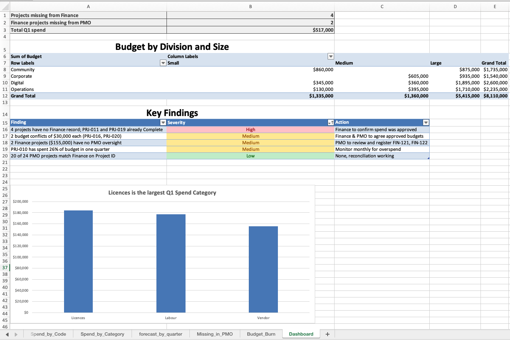
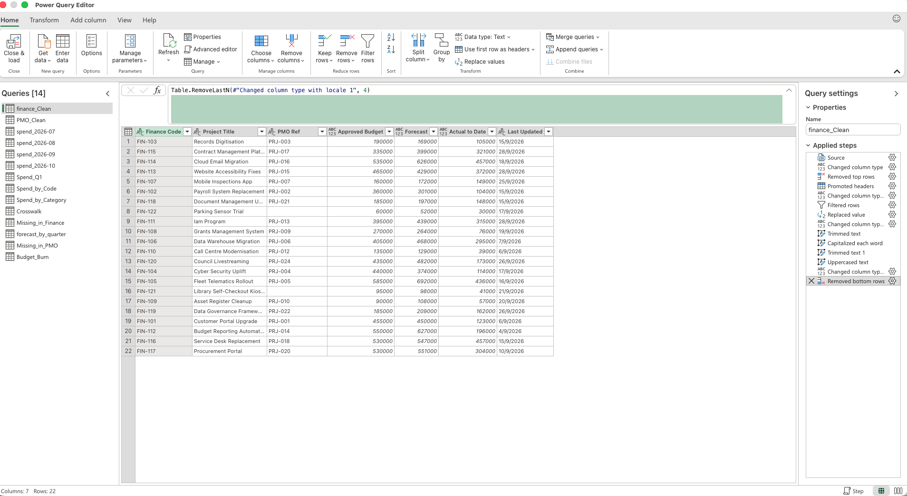

# Project Register Reconciliation (Excel + Power Query)

## The problem
A council's PMO and Finance teams kept separate project registers that didn't agree:
duplicate rows, inconsistent names, missing records and conflicting budgets.

## What I did
**Part 1 – Excel formulas:** cleaned data (TRIM, PROPER), matched registers with lookups,
flagged risks (COUNTIFS, nested IF), built pivots and an issue log of 12 findings.

**Part 2 – Power Query (automated):** rebuilt the same reconciliation as a refreshable pipeline:
- Cleaned a messy finance export (junk rows, "$" text, TEST/TOTAL rows, inconsistent IDs)
- Appended 3 monthly spend files and summarised with Group By
- Merged registers on Project ID (Left Outer = crosswalk; Left/Right Anti = missing records)
- Unpivoted quarterly forecasts from wide to long
- Calculated budget burn (Q1 spend ÷ approved budget)
- New data → one click **Refresh All** updates every table and the dashboard

## Key findings
- 20 of 24 projects match; 2 budget conflicts of $30,000 each remain
- 4 projects have no finance record — 2 are already marked Complete
- 2 finance projects ($155,000) have no PMO oversight
- One project has used 26% of its budget in a single quarter

## Dashboard

## Power Query steps

## Tools
Excel (XLOOKUP, COUNTIFS, SUMIFS, pivot tables, charts) · Power Query · Data validation · Conditional formatting
